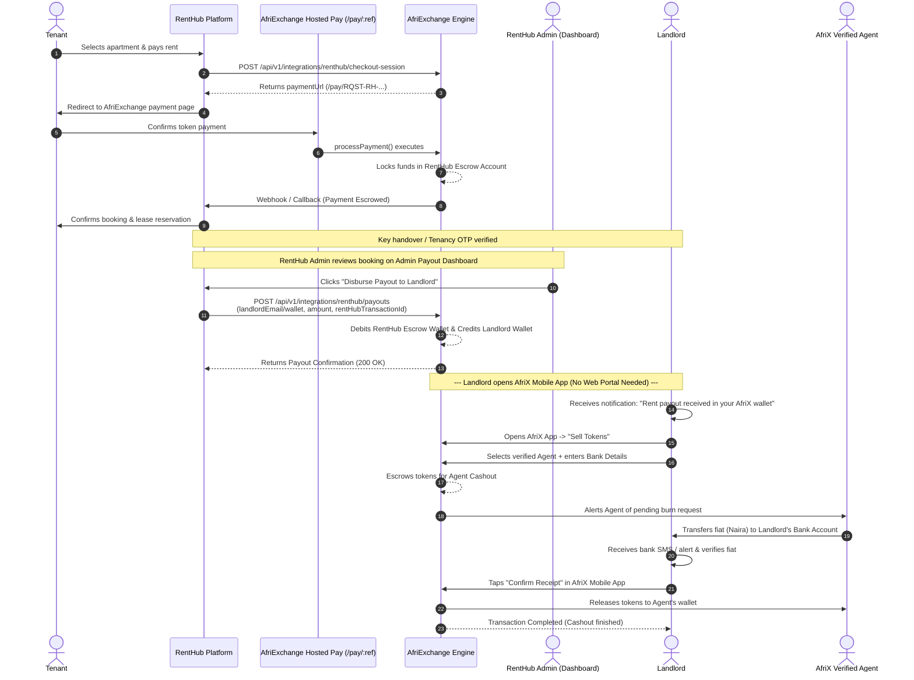
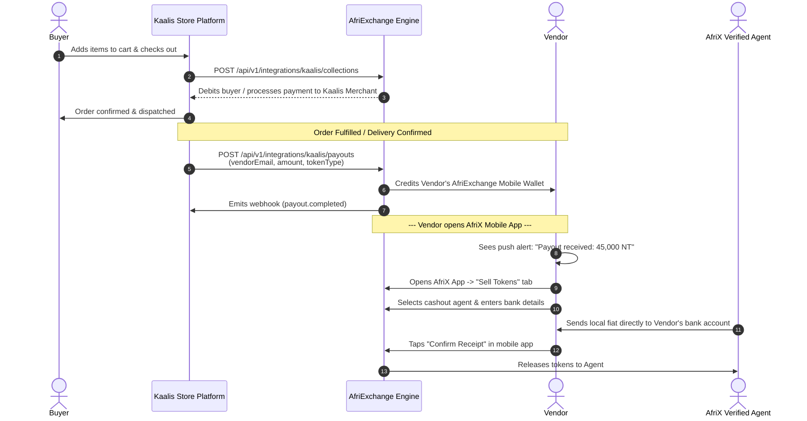
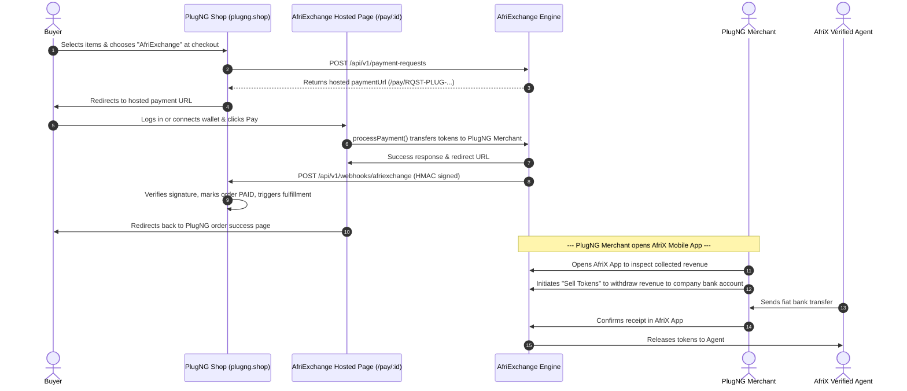

# AfriExchange Merchant Integration Flows & Mobile App Cashout Guide

> **Document Version:** 1.0  
> **Last Updated:** October 2026  
> **Applicable Platforms:** RentHub, Kaalis Store, PlugNG Shop, AfriExchange Core (Backend & AfriX Mobile)

---

## 📌 1. Architecture Principle: The AfriX App-First Model

In the AfriExchange ecosystem, **merchants, landlords, and marketplace vendors do not need to log into a web portal for daily operations or cashouts.**

- **Web Merchant Portal (`afrix-web`):** Built primarily for platform operators (e.g., RentHub administration, PlugNG admin, Kaalis ops) to configure webhook endpoints, view developer API keys, monitor aggregate platform metrics, and inspect high-level audit logs.
- **AfriX Mobile App (`afriX-mobile`):** The primary, all-in-one daily driver for beneficiaries (landlords, marketplace vendors, and store owners). It provides:
  1. Real-time token balance tracking (NT, CT, KT, etc.).
  2. Transaction history and notification feeds.
  3. Direct **Sell Through Agent (Cashout)** to convert tokens into local fiat bank deposits without intermediaries or desktop access.

---

## 🏢 2. RentHub Flow: Rent Escrow & Admin Landlord Payout

RentHub uses an **escrow-based checkout** to protect tenants and landlords. Rent payments are held in escrow in RentHub's settlement account until lease/handover conditions are satisfied. **Just like Kaalis Store pays vendors from its vendor dashboard, RentHub Admin initiates landlord payouts directly via the RentHub Admin Payout Dashboard.**

### 2.1 The Two Distinct Escrow Lifecycles

It is critical to distinguish between the two types of escrow:

1. **Rent Escrow (Platform Level):** Holds the tenant's rent payment in RentHub's escrow account until the tenancy start date or key handover OTP verification.
2. **Agent Burn Escrow (AfriExchange Cashout Level):** Once RentHub Admin triggers the payout and tokens are credited to the landlord's personal AfriX wallet, if the landlord wants fiat (e.g. NGN, XOF), the landlord initiates a "Sell Through Agent" burn request in the AfriX mobile app. AfriExchange holds those tokens in escrow until the agent transfers fiat to the landlord's bank account.

### 2.2 End-to-End Sequence Diagram

### 2.3 Explanatory Notes for RentHub

* **Admin Payout Dashboard (Parity with Kaalis Store):** Landlords do not interact with smart contracts or backend APIs. Instead, the RentHub Admin dispatches payouts from the RentHub Admin Payout Dashboard using `POST /api/v1/integrations/renthub/payouts`, exactly how Kaalis Store dispatches vendor payouts via `POST /api/v1/integrations/kaalis/payouts`.
* **Escrow Safety:** Until the RentHub Admin explicitly approves and initiates the payout from the RentHub Admin Dashboard, the rent tokens remain securely locked in the RentHub settlement/escrow account. Landlords only receive and control the tokens once the Admin payout is executed.
* **Deterministic Landlord Wallet Resolution:** When the RentHub Admin triggers the payout, AfriExchange resolves or creates the landlord's wallet automatically (`ethers.Wallet.createRandom()`) based on their `landlordAccountEmail`, `landlordWalletAddress`, or `landlordAfriExchangeUserId`.
* **Badges in Collections:** RentHub platform operators see `🛡️ Escrow` tags and escrow totals on the web dashboard collections page, whereas landlords manage their final payout balance exclusively in the mobile app.

---

## 🛍️ 3. Kaalis Store Flow: Multi-Vendor Collections & Direct Payouts

Kaalis Store is a multi-vendor marketplace where buyers purchase products from different vendors. AfriExchange provides both buyer checkout and instant vendor disbursement.

### 3.1 End-to-End Sequence Diagram

### 3.2 Explanatory Notes for Kaalis Store

* **No Seller Portal Friction:** Individual Kaalis vendors do not need an AfriExchange merchant account. They simply provide their AfriX account email or wallet address in Kaalis vendor settings.
* **Instant Wallet Resolution:** AfriExchange automatically matches the vendor by `vendorAfriExchangeUserId`, `vendorWalletAddress`, or `vendorAccountEmail`.
* **Idempotent Payouts:** Kaalis sends unique `idempotencyKey` values with each payout request to prevent double-crediting vendors on network retries.

---

## 🔌 4. PlugNG Shop Flow: Path A Hosted Checkout & Webhooks

PlugNG integrates via **Path A (Hosted Checkout)**. It allows e-commerce buyers across Africa (including XOF and NGN zones) to checkout with token balances.

### 4.1 End-to-End Sequence Diagram

### 4.2 Explanatory Notes for PlugNG

* **Zero Custom Checkout UI Needed:** PlugNG redirects buyers to the hosted `/pay/:id` page, which handles token verification, balance check, authorization, and PIN verification.
* **Signed Webhook Reconciliation:** Orders are not marked as paid until PlugNG's backend receives and cryptographically validates the `POST /api/v1/webhooks/afriexchange` payload.
* **Revenue Withdrawal:** The store owner can see their business tokens accumulating in their linked AfriX wallet and can cash out anytime via the mobile app.

---

## 📱 5. The AfriX Mobile App Cashout Flow (Under the Hood)

The entire cashout process for landlords, vendors, and merchants is housed in the `afriX-mobile` app under `app/(tabs)/sell-tokens`:

| Step | Screen File | User Action | System Action |
| :--- | :--- | :--- | :--- |
| **1. Overview** | `index.tsx` | Views available balance & enters amount to sell. | Validates token balance and displays active exchange rates. |
| **2. Agent Selection** | `select-agent.tsx` | Chooses an authorized, high-rating cashout agent. | Retrieves active agent list with liquidity and completion scores. |
| **3. Bank Details** | `bank-details.tsx` | Selects or inputs bank name, account number, or MoMo ID. | Resolves account name via NIBSS/Paystack/MoMo verification API. |
| **4. Confirmation** | `confirm.tsx` | Reviews conversion rate, payout amount, and fees. | Creates pending burn request; moves tokens into cashout escrow. |
| **5. Status & Release** | `status.tsx` | Monitors fiat transfer, then taps **"Confirm Receipt"**. | Releases escrowed tokens to the agent upon user confirmation. |

> [!IMPORTANT]
> **Fund Safety Guarantee:** When a landlord or vendor sells tokens, the tokens are held in a **secure escrow contract**. The agent **cannot** take the tokens until the landlord/vendor explicitly taps **"Confirm Receipt"** after verifying the fiat deposit in their personal bank app.

---

## 📊 6. Summary Comparison Across Integrations

| Feature | 🏠 RentHub | 🛍️ Kaalis Store | 🔌 PlugNG Shop |
| :--- | :--- | :--- | :--- |
| **Primary Integration Type** | Escrow Checkout + Admin Payout Dashboard | Direct Collection & Vendor Payout API | Path A Hosted Checkout + Webhooks |
| **Target User Group** | Tenants & Landlords | Marketplace Shoppers & Vendors | E-commerce Buyers & Merchants |
| **Payment Mechanism** | Pre-funded Escrow hold | Direct wallet debit / checkout | Hosted payment page (`/pay/:id`) |
| **Settlement Condition** | RentHub Admin dispatches payout via Dashboard | Order delivery / fulfillment | Instant on payment verification |
| **Recipient Identifier** | Landlord User ID / Email / Wallet | Vendor Email / AfriX ID / Wallet | Merchant ID / Linked Wallet |
| **Day-to-Day Cashout Portal** | **AfriX Mobile App** | **AfriX Mobile App** | **AfriX Mobile App** |
| **Web Portal Role** | Admin audit & escrow overview | Internal reporting | Webhook URL setup & API keys |

---

## 🛠️ 7. Developer & Ops Troubleshooting Reference

- **500 "Invalid payment destination"**: Ensure `createCheckoutSession` or `createCollection` resolves the `merchant_id` before creating pending transactions.
- **Missing Escrow Badge in Dashboard**: Check that pending transactions contain `metadata.collection_type = "rent_escrow"` and `metadata.source = "renthub"`.
- **Payout Webhook Failures**: Verify webhook URL configuration in the merchant portal and inspect `WebhookDelivery` logs for HMAC verification status.
